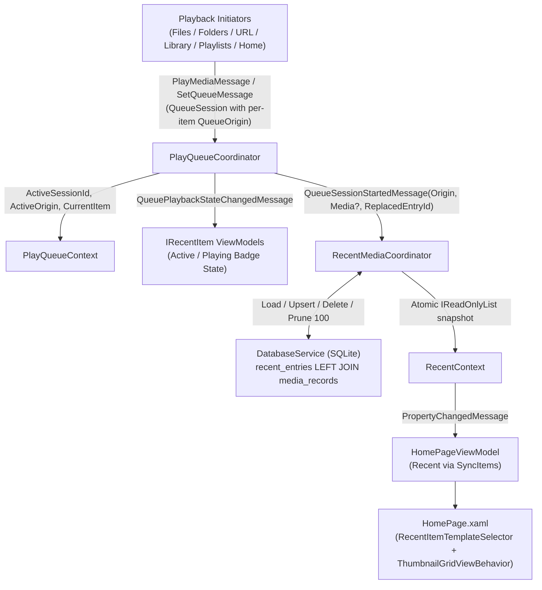

# Recent Media Tracking

This document explains the architecture, design rationale, and lifecycle of the Recent Media system on the Home page (`HomePage.xaml`).

## Overview & Design Goals

Previously, the Home page relied on the Windows Most Recently Used (`MostRecentlyUsedList`) cache, which only supported individual files, capped history at 25 items, and coupled persistence to the transient `HomePageViewModel`.

The current system replaces that with a SQLite-backed, play-queue-aware architecture built around three core ideas:

- **Live origin shortcuts instead of queue snapshots**: Recent entries (up to 100, ordered by `last_played DESC`) point to live sources — a single file/URL, a folder or `.m3u`/`.m3u8` file, a saved playlist, an album, or an artist. Re-opening a container card resolves its *current* live contents (such as newly added tracks or files) rather than replaying a stale snapshot, and avoids duplicating queue items in the database.
- **Per-item queue origins**: Rather than tracking a single origin for the entire play queue, each `QueueItemViewModel` slot carries its own optional container `QueueOrigin`. This allows mixed-origin queues (for example, playing an album and using *Play Next* or *Add to Queue* on a playlist or single track) to preserve accurate origin tracking without unlinking or guesswork.
- **Uniform, isolated card state**: Every card in Recent implements `IRecentItem` and listens to `QueuePlaybackStateChangedMessage` to compute its own active/playing state, ensuring at most one card displays the playing badge at a time without polluting canonical library ViewModels.

---

## Architecture

Because `HomePageViewModel` only exists while the user is on the Home page, whereas playback and library rescans happen globally, recent history is managed by a singleton coordinator (`RecentMediaCoordinator`) that publishes immutable snapshots to `RecentContext`.

| Component | Lifetime | Role |
|---|---|---|
| `QueueItemViewModel` | Per queue slot | Wraps a canonical `MediaViewModel` with slot-level playback state and an optional container `QueueOrigin? Origin` (`null` for individually tracked items). |
| `QueueOrigin` | Immutable record | Identifies a playback source (`Kind`, `SourceId`, `Title`, `Subtitle`, `Token`) and computes deterministic deduplication keys via `GetEntryId()`. |
| `PlayQueueCoordinator` | Singleton | Keeps `PlayQueueContext.ActiveOrigin` in sync with `CurrentItem?.Origin`, broadcasts `QueuePlaybackStateChangedMessage`, and emits `QueueSessionStartedMessage` when playback enters a new origin. |
| `RecentMediaCoordinator` | Singleton | Loads/persists `recent_entries`, hydrates placeholders, relinks library and playlist entities once scans finish, and publishes atomic `IRecentItem[]` snapshots to `RecentContext`. |
| `RecentContext` | Singleton | Observable state holder (`IReadOnlyList<IRecentItem> Recent`, `MaxRecentItems = 100`) that notifies `HomePageViewModel` when snapshots change. |
| `HomePageViewModel` | Transient | Mirrors `RecentContext.Recent` into a UI-bound `ObservableCollection<IRecentItem>` when `ShowRecent` is enabled and handles card and multi-selection commands. |

---

## Supported Entry Types (`IRecentItem`)

All five recent item types implement `IRecentItem` (`INotifyPropertyChanged`, `Name`, `IsPlaying`) and are deduplicated by `QueueOrigin.GetEntryId()` (`$"{(int)Kind}|{NormalizeLocation(SourceId)}"` — case-insensitive for file paths, ordinal for non-file URIs).

| `RecentItemKind` | ViewModel | `SourceId` | Template | Live Re-Playback |
|---|---|---|---|---|
| `SingleMedia` (`0`) | `RecentMediaItemViewModel` | File path or URI | `MediaGridViewItemTemplate` | Toggles play/pause if active individually; otherwise plays the file/URI standalone. |
| `MediaCollection` (`1`) | `MediaCollectionViewModel` | Folder path, `.m3u`/`.m3u8` path, or URI | `MediaCollectionGridViewItemTemplate` | Toggles play/pause if active; otherwise resolves the live folder/playlist via `IQueueService`. |
| `Playlist` (`2`) | `PlaylistViewModel` | `PlaylistViewModel.Id` | `PlaylistGridViewItemTemplate` | Plays current live `PlaylistViewModel.Items`. |
| `Album` (`3`) | `AlbumViewModel` | `AlbumViewModel.AlbumKey` | `AlbumGridViewItemTemplate` | Plays current live `AlbumViewModel.OrderedSongs`. |
| `Artist` (`4`) | `ArtistViewModel` | `ArtistViewModel.ArtistKey` | `ArtistGridViewItemTemplate` | Plays current live `ArtistViewModel.OrderedSongs`. |

---

## Queue Tracking & Per-Item Origins

### Why Per-Item Origins?

A queue often starts from one container (such as an album) and is later modified by *Play Next*, *Add to Queue*, item removal, or multi-selecting mixed items from Home or Playlists. Storing `Origin` on each `QueueItemViewModel` slot rather than on `QueueSession` means:

- Queue edits (`Enqueue`, `InsertNext`, `Remove`, `Shuffle`, `SendPlayNext`, `SendAddToQueue`) never need to wipe or unlink existing items' origins.
- Newly added container items carry their own `QueueOrigin`, while individual items leave `Origin` as `null`.
- `PlayQueueContext.ActiveOrigin` is always simply `CurrentItem?.Origin`. When playback crosses from an album track into a queued playlist or single file, the active origin updates naturally, the previous card deactivates, and the new origin is recorded or promoted in Recent.

### Recording & Deduplication

`PlayQueueCoordinator.BroadcastSessionStarted` runs whenever `CurrentItem` changes (or upgrades in-place):

- If the active slot has a container origin (`Origin is { TrackItemsIndividually: false }`), that container is recorded; otherwise the track is recorded individually as `SingleMedia`.
- Advancing between consecutive tracks of the same container within the same `SessionId` produces the same `entryId`, so no duplicate `QueueSessionStartedMessage` is emitted.
- Loose multi-file drops/selections, neighboring files auto-enqueued around a single opened file, and library-wide queues (e.g. *Songs*, *All Videos*, *FolderView*, *Search*) have `Origin == null` so each played track is recorded individually. Only explicitly opened or dropped folders create a folder `MediaCollection` entry.

### Deferred In-Place Upgrades

When opening an expandable stream URL (`PlayQueueCoordinator.CheckSubItemsAsync`), playback starts immediately as a single-item slot so playback is never blocked. If LibVLC subsequently discovers multiple sub-items for a standalone slot (`Origin == null`), the slot is replaced with sub-item slots carrying a `MediaCollection` origin, and `PlayQueueCoordinator` sends `QueueSessionStartedMessage` with `ReplacedEntryId` set to the temporary `SingleMedia` entry ID. `RecentMediaCoordinator` removes that specific entry and inserts the `MediaCollection` shortcut atomically — ensuring a delayed upgrade never accidentally removes a different track if the user already switched playback. (If the expandable item already belongs to a container such as a saved playlist, its expanded children preserve that container origin.)

---

## Playback State, Hydration & UI

### Why `RecentMediaItemViewModel` Exists

Canonical `MediaViewModel` instances are shared across library views (`SongsPage`, `AlbumDetailsPage`, `PlaylistDetailsPage`), where `MediaViewModel.IsPlaying` should be `true` whenever that track is playing in *any* context. On the Home page, however, only **one** card should show the playing badge: if an album is playing, the album card is active and any standalone Recent card for a track from that album must remain inactive (and clicking it should start the track standalone rather than pausing the album).

Wrapping `SingleMedia` cards in `RecentMediaItemViewModel` (implementing `IRecentItem`, `IMediaContainer`, and `IMediaPlaybackState`) solves this cleanly:
- It listens to `QueuePlaybackStateChangedMessage` just like `AlbumViewModel`, `ArtistViewModel`, `PlaylistViewModel`, and `MediaCollectionViewModel`, marking itself active only when `state.Origin` is `null` (or `TrackItemsIndividually`) and `state.CurrentItem` matches its `Media`.
- `MediaViewModel` stays completely free of HomePage-specific state, and `MediaMenuFlyout` handles `RecentMediaItemViewModel` automatically via `IMediaContainer` and `IMediaPlaybackState`.

### Startup Hydration, Relinking & `ShowRecent`

- **Placeholders & deferred relinking**: Recent entries load at startup before Music/Videos libraries and saved playlists finish scanning. Unresolved `Album`, `Artist`, and `Playlist` entries are hydrated as non-playable placeholders (`HasSongs == false` / `HasItems == false`) so the UI renders immediately without broken actions. Once `MainPageViewModel.FetchLibraries()` or a music library rescan completes (`!IsLoadingMusic`), `LoadAsync(forceReload: true)` swaps in live containers and upgrades `SingleMedia` wrappers to live music library songs (`FindMusicLibrarySong`) so *Show Album* and *Show Artist* context menu actions are available. Only the music library is searched because video items have no relational album/artist entities to relink.
- **Thread safety**: `RecentMediaCoordinator` synchronizes its internal `_entryIds`, `_items`, and load state with `Lock _stateLock`, and publishes immutable `IRecentItem[]` snapshots outside the lock via `Volatile.Read(ref _items)` so `RecentContext.Recent` never observes partial mutations.
- **`ShowRecent` setting**: `HomePageViewModel` controls visibility (hiding/clearing its local `Recent` list when disabled), while `RecentMediaCoordinator` skips recording and loading when disabled and marks `_isLoaded = false` if `MusicLibrary` updates while disabled so re-enabling refreshes retained cards.
- **Lazy thumbnails & metadata**: `ThumbnailGridViewBehavior` on `HomePage.xaml` decodes thumbnails only for realized/visible containers (supporting `AlbumViewModel`, `MediaViewModel`, `IMediaContainer`, and `StorageItemViewModel`), avoiding upfront decoding of up to 100 items. `LoadDetailsAsync()` probes missing metadata only for `RecentMediaItemViewModel` entries where `!Media.DetailsLoaded`.

---

## Persistence & UWP File Access

### Single-Table SQLite Cache (`recent_entries`)

`recent_entries` is a replaceable cache table managed in `DatabaseService.Schema.cs` and `DatabaseService.Recent.cs` (`id`, `kind`, `source_id`, `title`, `subtitle`, `token`, `last_played`).

To avoid disk I/O on startup for library-indexed files without duplicating metadata columns, `LoadRecentEntriesAsync` performs a single `LEFT JOIN media_records ON re.kind = @singleKind AND mr.path = re.source_id`. `UpsertRecentEntryAsync` upserts the entry, optionally deletes `replacedEntryId`, and prunes rows beyond `MaxRecentItems` in one transaction.

### MRU Tokens & Path Fallback

Because UWP apps without `broadFileSystemAccess` cannot reopen arbitrary paths outside declared libraries across restarts, top-level persisted shortcuts store WinRT access tokens in `recent_entries.token` (`EnsureFileAccessToken` for `SingleMedia`, `IFilesService.AddToRecent` for `MediaCollection` folders and playlist files). Tracks played inside container sessions do not write to `MostRecentlyUsedList`, preserving Windows' 25-entry MRU budget for top-level recent shortcuts.

When re-opening a `SingleMedia` or `MediaCollection` entry, lookups check `MostRecentlyUsedList` and `FutureAccessList` first (`FilesHelpers.TryGetFileFromTokenAsync` / `TryGetFolderFromTokenAsync`). If a token is missing or has been evicted by the 25-entry MRU cap, `FileMediaSource.GetStorageFileAsync` and `MediaCollectionViewModel` fall back to path-based access (`TryGetFileFromPathAsync` / `TryGetFolderFromPathAsync`), which succeeds for library and permitted locations and fails gracefully (`null`) for sandbox-restricted paths.
