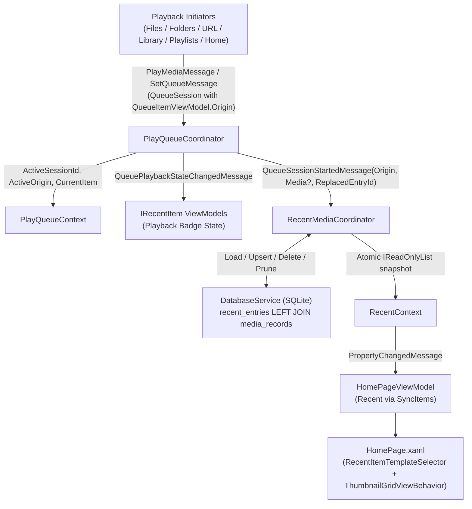

# Recent Media Tracking

Technical specification of the Recent Media system (`HomePage.xaml`), covering per-item queue origin tracking, playback state synchronization, hydration, and SQLite persistence.

## Architecture

Recent entries are **live origin shortcuts** (capped at `RecentContext.MaxRecentItems = 100`, ordered by `last_played DESC`) rather than play-queue snapshots. Re-opening any container card resolves and plays its current live contents.

Because `HomePageViewModel` is transient, recording, hydration, relinking, and persistence are owned by the singleton `RecentMediaCoordinator`.



| Component | Lifetime | Responsibility |
|---|---|---|
| `QueueItemViewModel` | Per queue slot | Wraps canonical `MediaViewModel` with slot playback state and optional container `QueueOrigin? Origin` (`null` = individually tracked). |
| `QueueOrigin` | Immutable record | Identifies an origin (`Kind`, `SourceId`, `Title`, `Subtitle`, `Token`, `TrackItemsIndividually`) and computes deterministic entry IDs (`GetEntryId()`). |
| `PlayQueueCoordinator` | Singleton | Maintains `PlayQueueContext.ActiveOrigin = CurrentItem?.Origin`, broadcasts `QueuePlaybackStateChangedMessage`, and emits `QueueSessionStartedMessage` via `RecordItemOrigin`. |
| `RecentMediaCoordinator` | Singleton | Persists/loads `recent_entries`, hydrates placeholders, relinks library/playlist entities on `LoadAsync(forceReload: true)`, and publishes immutable `IRecentItem[]` snapshots to `RecentContext.Recent`. |
| `RecentContext` | Singleton | `ObservableRecipient` holding `IReadOnlyList<IRecentItem> Recent` (`[NotifyPropertyChangedRecipients]`). |
| `IRecentItem` | Interface | Shared contract (`INotifyPropertyChanged`, `Name`, `IsPlaying`) implemented by all 5 recent card ViewModels. |
| `RecentMediaItemViewModel` | Per single-media card | `IMediaContainer` + `IMediaPlaybackState` wrapper around `MediaViewModel` tracking individual active/playing state via `QueuePlaybackStateChangedMessage`. |
| `MediaCollectionViewModel` | Per folder / `.m3u` card | Live shortcut to a folder, `.m3u`/`.m3u8` file, or expandable URI; resolves current items on demand via `IQueueService`. |
| `HomePageViewModel` | Transient | Mirrors `RecentContext.Recent` into `ObservableCollection<IRecentItem> Recent` when `ShowRecent` is enabled and dispatches card/multi-select commands. |

---

## Entry Types (`IRecentItem`)

Entries are deduplicated by `QueueOrigin.GetEntryId()` (`$"{(int)Kind}|{NormalizeLocation(SourceId)}"`, where file paths are lowercased and non-file URIs use ordinal comparison).

| `RecentItemKind` | ViewModel | `SourceId` | Template | Hydration & Re-Playback |
|---|---|---|---|---|
| `SingleMedia` (`0`) | `RecentMediaItemViewModel` | File path or URI | `MediaGridViewItemTemplate` | Hydrated via MRU `token` → library lookup → path/URI fallback + `LEFT JOIN media_records`. Clicking toggles play/pause if `IsMediaActive`, otherwise sends `PlayMediaMessage`. |
| `MediaCollection` (`1`) | `MediaCollectionViewModel` | Folder path, `.m3u`/`.m3u8` path, or URI | `MediaCollectionGridViewItemTemplate` | Resolved live via `token` → path fallback → `IQueueService`. Clicking toggles if `IsQueueActive`, otherwise parses and queues live contents. |
| `Playlist` (`2`) | `PlaylistViewModel` | `PlaylistViewModel.Id` | `PlaylistGridViewItemTemplate` | Resolved from `PlaylistsContext.Playlists` (or non-playable placeholder via `LoadPlaceholder`). Invokes `PlayCommand`. |
| `Album` (`3`) | `AlbumViewModel` | `AlbumViewModel.AlbumKey` | `AlbumGridViewItemTemplate` | Resolved from `LibraryContext.Music.Albums` (or empty placeholder). Invokes `PlayAlbumCommand`. |
| `Artist` (`4`) | `ArtistViewModel` | `ArtistViewModel.ArtistKey` | `ArtistGridViewItemTemplate` | Resolved from `LibraryContext.Music.Artists` (or empty placeholder). Invokes `PlayArtistCommand`. |

---

## Queue Tracking & Per-Item Origins

### Per-Item `QueueOrigin` & Mixed Queues

Each `QueueItemViewModel` stores its own optional container `Origin`:
- **Container origin** (`Origin is { TrackItemsIndividually: false }`): `Album`, `Artist`, `Playlist`, or `MediaCollection` with a non-empty `SourceId`.
- **Individual item** (`Origin is null`): standalone files/URIs, library-wide queues (`QueueOrigin.ForLibraryQueue`), loose multi-file drops/selections, or single items added via `Play Next` / `Add to Queue`.

Queue mutations (`Enqueue`, `InsertNext`, `Remove`, `Shuffle`, `SendPlayNext`, `SendAddToQueue`) **preserve existing slots' origins** without unlinking. Container actions (`Play Next`, `Add to Queue`, multi-selecting mixed recent/playlist items) stamp each inserted `QueueItemViewModel` with its source `QueueOrigin`.

### Recording Rules (`PlayQueueCoordinator.RecordItemOrigin`)

When `CurrentItem` changes (or upgrades in-place in `ApplyQueueSnapshot`):
1. Compute `effectiveOrigin = item.Origin ?? QueueOrigin.ForSingleMedia(item.Media)` and `entryId = effectiveOrigin.GetEntryId()`.
2. If `replacedEntryId is null && _queueSession.SessionId == _recordedSessionId && entryId == _lastRecordedEntryId`, skip broadcasting (advancing between tracks of the same container emits nothing).
3. Otherwise update `(_recordedSessionId, _lastRecordedEntryId, _lastRecordedOriginKind)` and send `QueueSessionStartedMessage(effectiveOrigin, singleMedia, replacedEntryId)`.

| Action | Playable Count | Recorded Entry |
|---|---|---|
| Open/drop folder | ≥ 1 | `MediaCollection` (folder shortcut) |
| Open/drop `.m3u` / `.m3u8` | ≥ 1 | `MediaCollection` (playlist file shortcut) |
| Play `Playlist`, `Album`, or `Artist` | ≥ 1 | `Playlist` / `Album` / `Artist` |
| Loose multi-file drop / selection | ≥ 2 | Each played track recorded as `SingleMedia` |
| Single file (`EnqueueAllFilesInFolder` on) | 1 / ≥ 2 | `SingleMedia` / upgraded to folder `MediaCollection` |

### Deferred In-Place Upgrades (`ReplacedEntryId`)

Two flows start as a single-item slot (`Origin == null`) and expand within the same `SessionId`:
1. **Neighboring files** (`MessengerExtensions.PlayFilesAsync` → `QueueService.AddNeighboringFilesAsync`): preserves the active `QueueItemViewModel` reference and stamps `folderOrigin` onto all slots via `QueueSession.SetOrigin`. `ApplyQueueSnapshot` detects the unchanged `CurrentItem` transitioning from `SingleMedia` to `MediaCollection` and sends `ReplacedEntryId`.
2. **Expandable URL sub-items** (`PlayQueueCoordinator.CheckSubItemsAsync`): replaces the active slot with `QueueItemViewModel`s carrying `MediaCollection(title, url)` and sends `ReplacedEntryId` before selecting the first sub-item.

`RecentMediaCoordinator` removes `ReplacedEntryId` from memory and SQLite atomically (`UpsertRecentEntryAsync`) while inserting the upgraded `MediaCollection` entry.

---

## State Synchronization, Hydration & UI

### Exclusive Playback Badge State

All five `IRecentItem` types listen to `QueuePlaybackStateChangedMessage` (and query `QueuePlaybackStateRequestMessage` on construction), ensuring at most **one** Recent card shows the active playing badge:
- **Container cards** (`Album`, `Artist`, `Playlist`, `MediaCollection`): `IsQueueActive = state.SessionId != Guid.Empty && state.CurrentItem is not null && (state.Origin?.Matches(kind, sourceId) ?? false)`.
- **`RecentMediaItemViewModel`**: `IsMediaActive = state.SessionId != Guid.Empty && state.CurrentItem is not null && (state.Origin is null || state.Origin.TrackItemsIndividually) && matches Media` (by reference or normalized location). `MediaViewModel.IsPlaying` remains strictly track-level for library/queue views, and `MediaMenuFlyout` handles `RecentMediaItemViewModel` via `IMediaContainer` + `IMediaPlaybackState`.

### Concurrency, Relinking & `ShowRecent`

- **Thread safety**: `RecentMediaCoordinator` guards `_entryIds`, `_items`, `_loadTask`, `_loadCts`, and `_isLoaded` with `Lock _stateLock`. Snapshots (`IRecentItem[]`) are published outside the lock via `Volatile.Read(ref _items)` to `RecentContext.Recent`.
- **Deferred relinking**: Startup loads before library/playlist scans hydrate `Album`, `Artist`, and `Playlist` entries as non-playable placeholders (`HasSongs == false` / `HasItems == false`). After `MainPageViewModel.FetchLibraries()` or completed music rescans (`PropertyChangedMessage<MusicLibrary>` with `!IsLoadingMusic`), `LoadAsync(forceReload: true)` swaps in live containers and upgrades `SingleMedia` wrappers to live music library songs (`FindMusicLibrarySong`) so **Show Album** / **Show Artist** actions work, while reusing existing `MediaCollectionViewModel` and non-upgraded `RecentMediaItemViewModel` instances.
- **Playlist deletion**: Removing a playlist from `PlaylistsContext.Playlists` removes its matching recent entry.
- **`ShowRecent` setting**: `HomePageViewModel` hides/clears its local `Recent` collection when `ShowRecent` is off. `RecentMediaCoordinator` skips recording and loading while disabled, and marks `_isLoaded = false` if `MusicLibrary` updates while disabled so re-enabling refreshes retained cards.
- **Lazy thumbnails & details**: `ThumbnailGridViewBehavior` on `HomePage.xaml` decodes thumbnails only for realized containers (handling `AlbumViewModel`, `MediaViewModel`, `IMediaContainer`, and `StorageItemViewModel`). `LoadDetailsAsync()` probes missing metadata only for `RecentMediaItemViewModel` entries where `!Media.DetailsLoaded`.

---

## Persistence & UWP File Access

### SQLite (`recent_entries`)

Managed as a replaceable cache table in `DatabaseService.Schema.cs` and `DatabaseService.Recent.cs`:

```sql
recent_entries (
    id TEXT PRIMARY KEY,
    kind INTEGER NOT NULL,
    source_id TEXT NOT NULL,
    title TEXT NOT NULL,
    subtitle TEXT,
    token TEXT,
    last_played INTEGER NOT NULL
)
```

`LoadRecentEntriesAsync` performs a single `LEFT JOIN media_records ON re.kind = @singleKind AND mr.path = re.source_id` so library-indexed `SingleMedia` items hydrate cached metadata without disk I/O. `UpsertRecentEntryAsync` upserts the entry, optionally deletes `replacedEntryId`, and prunes rows beyond `maxCount` in a single transaction.

### MRU Tokens & Path Fallback

Because UWP apps without `broadFileSystemAccess` cannot reopen arbitrary paths outside declared libraries across restarts, top-level persisted shortcuts retain WinRT access tokens in `recent_entries.token`:
- `SingleMedia`: `RecentMediaCoordinator.EnsureFileAccessToken` adds the `StorageFile` to `MostRecentlyUsedList` and stores the token on `IFileMediaSource.Token` and `recent_entries.token`.
- `MediaCollection`: `QueueService` captures the token from `IFilesService.AddToRecent(item)` into `QueueOrigin.Token`.
- Tracks played inside container sessions do not write to `MostRecentlyUsedList`, preserving its 25-entry budget for top-level recent shortcuts.
- **Fallback**: `FilesHelpers.TryGetFileFromTokenAsync` / `TryGetFolderFromTokenAsync` check both `MostRecentlyUsedList` and `FutureAccessList`; if a token is missing or evicted, `FileMediaSource.GetStorageFileAsync` and `MediaCollectionViewModel` fall back to path access (`TryGetFileFromPathAsync` / `TryGetFolderFromPathAsync`), which succeeds for library/permitted locations and fails gracefully (`null`) for sandbox-restricted paths.
