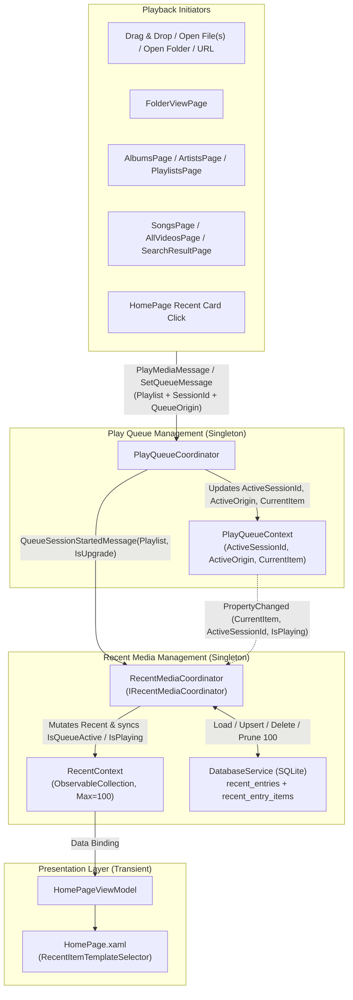

# 🕒 Recent Media Tracking System

This document describes the architecture, data model, queue session lifecycle, and UI behavior of the Recent Media tracking system on the Home page (`HomePage.xaml`).

---

## 📋 Table of Contents

- [📖 Overview](#-overview)
- [🏗️ Architecture & Components](#️-architecture--components)
- [📦 Supported Recent Entry Types (`RecentItemKind`)](#-supported-recent-entry-types-recentitemkind)
- [🔄 Queue Session Lifecycle & Tracking Rules](#-queue-session-lifecycle--tracking-rules)
  - [Container vs. Individual Item Tracking](#container-vs-individual-item-tracking)
  - [Explicit vs. Implicit 1-Item Containers](#explicit-vs-implicit-1-item-containers)
  - [Deferred Session Upgrades](#deferred-session-upgrades)
  - [In-Queue Mutations](#in-queue-mutations)
- [🔑 Deduplication & Re-Playback Semantics](#-deduplication--re-playback-semantics)
- [⚡ Active & Playing State Synchronization](#-active--playing-state-synchronization)
- [💾 SQLite Persistence & UWP File Access](#-sqlite-persistence--uwp-file-access)

---

## 📖 Overview

Screenbox's Recent Media system operates at the **play queue session and playlist level** rather than tracking individual `StorageFile` items via the Windows MRU (`MostRecentlyUsedList`).

Key characteristics:
- **Capacity**: Up to **100 items** (`RecentContext.MaxRecentItems = 100`), ordered by `last_played DESC`.
- **Supported Sources**: Single local files, network/stream URLs, dropped or opened folders, implicit folder neighbor queues, `.m3u`/`.m3u8` playlist files, multi-file selections, User Playlists, Albums, and Artists.
- **Session Stability**: Advancing (`Next`/`Previous`), picking another track in the Play Queue, shuffling/unshuffling, or adding/removing items in an active container session keeps that container entry active on the Home page without flooding Recent with child tracks.

---

## 🏗️ Architecture & Components

Because `HomePageViewModel` is transient and only alive while the user is viewing the Home page, all session tracking, active/playing state synchronization, library/playlist entity linking, and SQLite persistence are owned by a singleton coordinator (`RecentMediaCoordinator`).

| Component | Lifetime | Responsibility |
|---|---|---|
| `Playlist` | Per queue snapshot | Carries `SessionId` (`Guid`), `Origin` (`QueueOrigin?`), and `GetCanonicalItems()` (returns `ShuffleBackup.OriginalItems` when shuffled). |
| `QueueOrigin` | Immutable record | Describes how a queue session was created (`Kind`, `ContentHash`, `Title`, `Subtitle`, `SourceId`, `TrackItemsIndividually`). |
| `PlayQueueCoordinator` | Singleton | Owns the active `Playlist`, updates `PlayQueueContext.ActiveSessionId` and `ActiveOrigin`, and broadcasts `QueueSessionStartedMessage`. |
| `RecentMediaCoordinator` | Singleton | Listens to `QueueSessionStartedMessage`, `PlayQueueContext`, `LibraryContext`, and `PlaylistsContext`; updates `RecentContext.Recent` and persists to SQLite. |
| `RecentContext` | Singleton | Holds `ObservableCollection<RecentItemViewModel> Recent` and `MaxRecentItems = 100`. |
| `RecentItemViewModel` | Per recent entry | Observable presentation model for a card on `HomePage`, supporting all 5 `RecentItemKind` values. |
| `HomePageViewModel` | Transient | Binds `RecentContext.Recent` to `HomePage.xaml` and forwards UI commands (`Play`, `Remove`, multi-select actions) to `IRecentMediaCoordinator`. |

---

## 📦 Supported Recent Entry Types (`RecentItemKind`)

| `RecentItemKind` | Trigger Scenarios | Home Card Template | Stored in `recent_entry_items`? |
|---|---|---|---|
| `SingleMedia` (`0`) | Single local file, network/stream URL, or individual track from a library-wide queue (`SongsPage`, `AllVideosPage`, `SearchResultPage` songs). | `RecentMediaGridViewItemTemplate` | **Yes** (1 row) |
| `MediaCollection` (`1`) | Dropped/opened folder, auto-enqueued neighbor folder ($\ge 2$ playable files), `.m3u`/`.m3u8` playlist file, multi-file selection, or URL with sub-items. | `RecentPlaylistGridViewItemTemplate` (`PlaylistGlyph`) | **Yes** ($N$ rows in canonical order) |
| `Playlist` (`2`) | Playing a saved playlist from `PlaylistsPage` or `PlaylistDetailsPage`. | `RecentPlaylistGridViewItemTemplate` (`PlaylistGlyph`) | **No** (0 rows; resolved live from `PlaylistsContext`) |
| `Album` (`3`) | Playing an album from `AlbumsPage`, `AlbumDetailsPage`, or `SearchResultPage`. | `RecentAlbumGridViewItemTemplate` | **No** (0 rows; resolved live from `LibraryContext.Music.Albums`) |
| `Artist` (`4`) | Playing an artist from `ArtistsPage`, `ArtistDetailsPage`, or `SearchResultPage`. | `RecentArtistGridViewItemTemplate` | **No** (0 rows; resolved live from `LibraryContext.Music.Artists`) |

---

## 🔄 Queue Session Lifecycle & Tracking Rules

### Container vs. Individual Item Tracking

`QueueOrigin.TrackItemsIndividually` determines whether a queue session is tracked as a single container entry or per track:

1. **Container Sessions (`TrackItemsIndividually == false`)**:
   - Applies to `MediaCollection`, `Playlist`, `Album`, and `Artist`.
   - Recorded **once** when the queue session is loaded (`ApplyQueueSnapshot`).
   - Advancing (`Next`/`Previous`), auto-advancing on media end, or clicking a different track inside the Play Queue (`PlayMediaMessage(item, existing: true)`) preserves `SessionId` and `Origin` and **does not** add new entries to Recent.

2. **Individual Track Sessions (`TrackItemsIndividually == true`)**:
   - Applies to `SingleMedia` and library-wide queues (`QueueOrigin.ForLibraryQueue` from `SongsPage`, `AllVideosPage`, and `SearchResultPage` songs).
   - Recorded in `ProcessCurrentItemChangedAsync` whenever `PlayQueueContext.CurrentItem` changes.
   - Playing a song on `SongsPage` or a video on `AllVideosPage` records that item as a `SingleMedia` entry, and **advancing to subsequent tracks in that library-wide queue records each newly played track as a `SingleMedia` entry** (or promotes it to the top if already in Recent).

### Explicit vs. Implicit 1-Item Containers

| User Action | Playable Files Count | Recorded `RecentItemKind` | Rationale |
|---|---|---|---|
| Explicitly drop a folder or use **Open Folder** | $1$ | `MediaCollection` (1-item folder playlist) | User action is explicitly a folder container. |
| Explicitly drop or open an `.m3u`/`.m3u8` file | $1$ | `MediaCollection` (1-item playlist) | User action is explicitly a playlist file. |
| Play a `Playlist`, `Album`, or `Artist` | $1$ | `Playlist` / `Album` / `Artist` | Explicit domain container. |
| Open/drop a single file (with `EnqueueAllFilesInFolder` enabled) or click a file in `FolderViewPage` | $1$ | `SingleMedia` | Only playable file in the folder; collapses to single media visual. |
| Open/drop a single file (with `EnqueueAllFilesInFolder` enabled) or click a file in `FolderViewPage` | $\ge 2$ | `MediaCollection` (folder playlist) | Neighboring files were automatically enqueued into a folder playlist. |

### Deferred Session Upgrades

Two playback flows start as a 1-item `SingleMedia` queue and asynchronously expand within the **same** `SessionId`:

1. **Neighboring Files Auto-Enqueue (`MessengerExtensions.PlayFilesAsync` → `PlaylistService.AddNeighboringFilesAsync`)**:
   - `PlayFilesAsync` immediately sends a 1-item `SetQueueMessage` (`SingleMedia`) so playback begins without waiting for folder enumeration.
   - `AddNeighboringFilesAsync` enumerates the parent folder. If $> 1$ playable files are found, it sends a second `SetQueueMessage` with the **same** `SessionId` and `Origin = QueueOrigin.ForMediaCollection(folderName, folderPath, neighboringFiles)`.
2. **Expandable URL Sub-Items (`PlayQueueCoordinator.CheckSubItemsAsync`)**:
   - Opening a URL starts as `SingleMedia`. If LibVLC parses $> 1$ sub-items, `CheckSubItemsAsync` upgrades `_queueSession.Origin` to `MediaCollection` with the same `SessionId`.

When `PlayQueueCoordinator` detects that `queueSession.SessionId == _recordedSessionId` and `_recordedOriginKind` transitions from `SingleMedia` to `MediaCollection`, it sends `QueueSessionStartedMessage(playlist, IsUpgrade: true)`. `RecentMediaCoordinator` replaces the temporary 1-file `SingleMedia` entry in-place (`replaceEntryId`) with the upgraded `MediaCollection` entry (or merges into an existing identical `MediaCollection` entry).

### In-Queue Mutations

While a queue session is active, the following operations preserve `_queueSession.SessionId` and `_queueSession.Origin` and never create a new Recent entry:
- Shuffling or unshuffling (`HandleShuffleModeChanged`)
- Adding items (`Enqueue`, `InsertNext`, `SendPlayNext`, `SendAddToQueue`)
- Removing items (`Remove`)
- Reordering items (`OnCollectionChanged`)

Clearing the queue (`ClearQueue()`) resets `ActiveSessionId = Guid.Empty` and `ActiveOrigin = null`, deactivating all `RecentItemViewModel` cards.

---

## 🔑 Deduplication & Re-Playback Semantics

Every `QueueOrigin` computes a deterministic `ContentHash` (`recent_entries.content_hash` `UNIQUE`):

| `RecentItemKind` | `ContentHash` Formula | Deduplication Rule | Re-Playback Behavior from Home Page |
|---|---|---|---|
| `SingleMedia` | `"media:" + Location` | Same file path or URL promotes existing card to index 0. | Sends `PlayMediaMessage(Media, existing: false)`. |
| `MediaCollection` | `"adhoc:" + SHA256(CanonicalLocations joined by '\n')` | Promoted to index 0 **only if** the canonical (unshuffled) item `Location` sequence is **100% identical**. If a file was added/removed in the folder, a new `MediaCollection` entry is created. | Restores snapshot items from `recent_entry_items` at `InitialIndex` via `SetQueueMessage`. |
| `Playlist` | `"playlist:" + PlaylistId` | Always matches the same User Playlist across edits. | Loads **fresh** `LinkedPlaylist.Items` starting at index `0`. |
| `Album` | `"album:" + Name.ToLowerInvariant() + "\0" + ArtistName.ToLowerInvariant()` | Always matches the same Album. | Loads **fresh** `LinkedAlbum.OrderedSongs` starting at index `0`. |
| `Artist` | `"artist:" + Name.ToLowerInvariant()` | Always matches the same Artist. | Loads **fresh** `LinkedArtist.OrderedSongs` starting at index `0`. |

---

## ⚡ Active & Playing State Synchronization

`AlbumViewModel`, `ArtistViewModel`, and `PlaylistViewModel` set their own `IsPlaying = true` whenever *any* song they contain is played from anywhere in the app. To prevent a Recent card for an Album/Artist/Playlist from falsely showing a Pause icon when one of its songs is played standalone, `RecentItemViewModel` does **not** bind to `LinkedAlbum.IsPlaying`, `LinkedArtist.IsPlaying`, or `LinkedPlaylist.IsPlaying`.

Instead, `RecentMediaCoordinator.UpdateActiveStates()` drives `IsQueueActive` and `IsPlaying` on every `RecentItemViewModel`:

- For `SingleMedia`:
  - `IsQueueActive` is `true` iff the active queue session tracks items individually (`ActiveOrigin is null || ActiveOrigin.TrackItemsIndividually`) and `Media.Location == PlayQueueContext.CurrentItem.Location`.
- For `MediaCollection`, `Playlist`, `Album`, `Artist`:
  - `IsQueueActive` is `true` iff `ActiveSessionId == PlayQueueContext.ActiveSessionId` and `ContentHash == PlayQueueContext.ActiveOrigin.ContentHash`.
- For all kinds:
  - `IsPlaying = IsQueueActive && PlayQueueContext.IsPlaying`.

Clicking anywhere on a card body or its hover Play/Pause button on `HomePage` invokes `RecentItemViewModel.Play()`:
- If `IsQueueActive == true`: sends `TogglePlayPauseMessage(false)` to toggle playback of the current active item in the queue.
- If `IsQueueActive == false`: loads and starts the item or container session.

---

## 💾 SQLite Persistence & UWP File Access

### Database Tables (`screenbox.db`)

`recent_entries` and `recent_entry_items` are replaceable cache tables (see `DatabaseService.Schema.cs` and `DatabaseService.Recent.cs`):

- **`recent_entries`**:
  - `id` (`TEXT PRIMARY KEY`), `entry_kind` (`INTEGER`), `content_hash` (`TEXT UNIQUE`), `title` (`TEXT`), `subtitle` (`TEXT`), `source_id` (`TEXT`), `current_index` (`INTEGER`), `last_played` (`INTEGER`, UTC ticks).
- **`recent_entry_items`**:
  - `entry_id` (`TEXT REFERENCES recent_entries(id) ON DELETE CASCADE`), `item_order` (`INTEGER`), `path` (`TEXT`), `title` (`TEXT`), `media_type` (`INTEGER`).
  - Only populated for `SingleMedia` and `MediaCollection`. Hydrated at startup via `LEFT JOIN media_records ON media_records.path = recent_entry_items.path` to avoid disk I/O for library files.

### UWP Sandbox Access (`MostRecentlyUsedList`)

Because Screenbox runs in the UWP app container without `broadFileSystemAccess`, files and folders outside the Music/Videos libraries require OS-level access tokens across app restarts. `PlayQueueCoordinator` and `PlaylistService` continue to register opened `StorageFile`s and `StorageFolder`s with `StorageApplicationPermissions.MostRecentlyUsedList` via `IFilesService.AddToRecent` purely to retain WinRT file-system access permissions, while `RecentMediaCoordinator` and SQLite own the recent list data and ordering.
